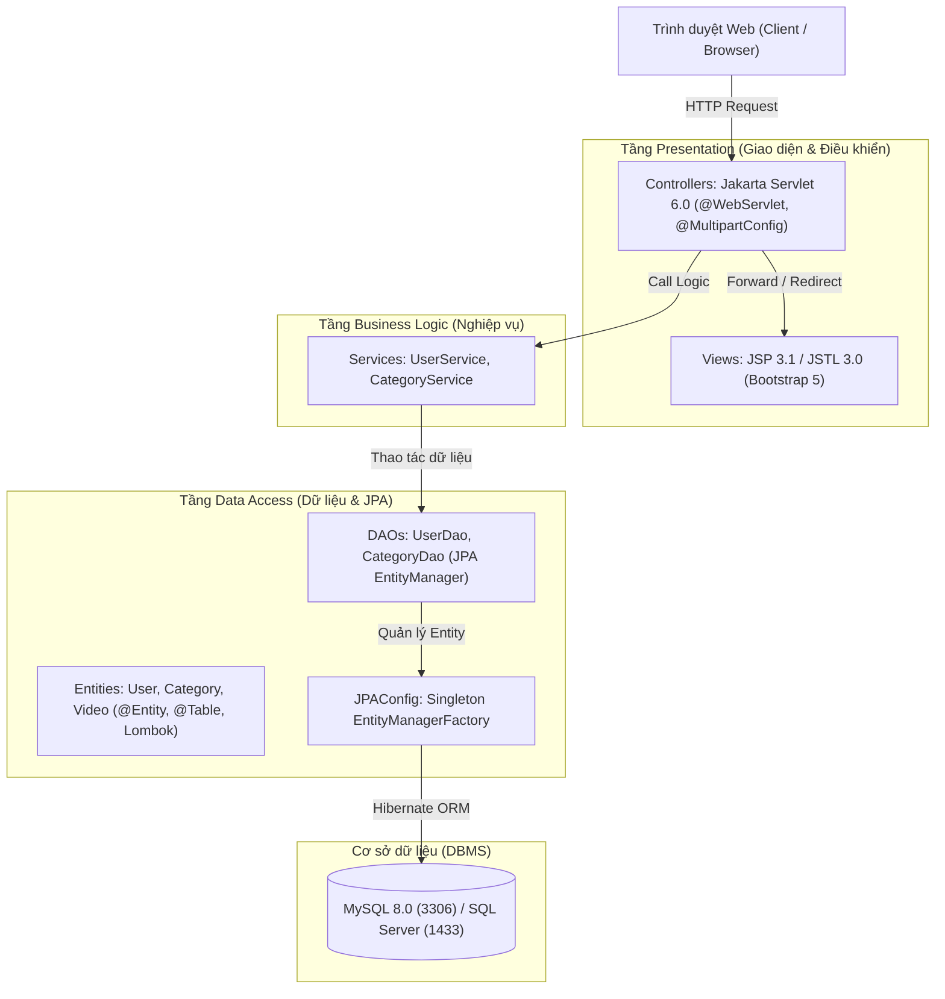

# TRƯỜNG ĐẠI HỌC CÔNG NGHỆ KỸ THUẬT THÀNH PHỐ HỒ CHÍ MINH
## KHOA CÔNG NGHỆ THÔNG TIN
### MÔN HỌC: LẬP TRÌNH WEB (WEBPR330479)
#### BÀI TẬP THỰC HÀNH - BUỔI HỌC NGÀY 12/11/2026
---

### THÔNG TIN SINH VIÊN
- **Họ và tên:** Trương Gia Kiệt
- **Mã số sinh viên (MSSV):** 24110032
- **Lớp:** 24110CTNB
- **Môn học:** Lập Trình Web
- **Giảng viên hướng dẫn:** ThS. Nguyễn Hữu Trung
- **Hệ thống nộp bài:** UTE-LMS (https://utexlms.hcmute.edu.vn)

---

## 📄 TÀI LIỆU BÁO CÁO (WORD)
- [Báo cáo tổng hợp (Bài 1 & Bài 2)](./BAO_CAO_BAI_TAP_12.11.2026.docx)
- [Báo cáo Bài tập 01](./1/Bao_Cao_Bai_1_JPA.docx)
- [Báo cáo Bài tập 02](./2/Bao_Cao_Bai_2_CRUD_JPA.docx)

---

## 📌 TỔNG QUAN NỘI DUNG BÀI TẬP
Kho lưu trữ này chứa toàn bộ mã nguồn của buổi thực hành ngày **12/11/2026** về chuyên đề **Jakarta Persistence API (JPA 3.0 / 3.1) và Hibernate ORM**, được chia làm 2 bài tập độc lập:

| Thư mục | Tên bài tập | Mô tả tóm tắt | Công nghệ chính |
| :---: | :--- | :--- | :--- |
| [📁 **`1/`**](./1) | **Bài tập 01 (Chuyển đổi bài 09/11 sang JPA)** | Kế thừa trọn vẹn đồ án MVC 3 tầng (Login, Register, Remember Me, Category CRUD). Giữ nguyên toàn bộ Controller, Service, Views; chuyển đổi 100% tầng Data Access và Entity Model từ JDBC sang JPA. | Jakarta EE 10, Servlet 6.0, JPA 3.1, Hibernate ORM 6.6, MySQL / SQL Server |
| [📁 **`2/`**](./2) | **Bài tập 02 (CRUD Category & Video JPA 3.0)** | Xây dựng chức năng quản lý danh mục Category và Video liên kết với JPA 3.0, hỗ trợ phân trang, đếm số lượng, tìm kiếm, upload ảnh đa phương tiện, tối ưu mã nguồn bằng Project Lombok. | Jakarta Servlet 6.0, JPA 3.0, Hibernate ORM 6.6, Lombok, Bean Validation, Bootstrap 5 |

---

## 🏗️ KIẾN TRÚC HỆ THỐNG & CÔNG NGHỆ SỬ DỤNG



---

## 🛠️ HƯỚNG DẪN CẤU HÌNH VÀ CHẠY DỰ ÁN

### 1. Yêu cầu môi trường
- **Java Development Kit (JDK):** JDK 17 hoặc JDK 21 LTS (Oracle / Eclipse Adoptium Temurin).
- **Apache Maven:** Phiên bản 3.8.0 trở lên.
- **Hệ quản trị CSDL:** 
  - **MySQL 8.0+** (Cổng `3306`, user: `root`, password mặc định: `123456`)
  - Hoặc **Microsoft SQL Server** (Cổng `1433`, user: `sa`, password: `1234567@a$`)
- **Web Server:** Apache Tomcat 10.1 hoặc Tomcat 11 (hỗ trợ `jakarta.servlet.*`).

---

### 2. Hướng dẫn chạy Bài tập 1 (`1/`)
Bài tập 1 lưu tại thư mục [`1/`](./1). Chạy kiểm thử tự động tầng Data JPA:
```bash
cd 1
mvn compile exec:java -Dexec.mainClass="vn.iotstar.config.TestJPA"
```
Đóng gói ra file WAR để chạy trên Tomcat:
```bash
mvn clean package
```
File WAR: `target/24110032_TruongGiaKiet_BT12.11.2026_Bai1.war`.

---

### 3. Hướng dẫn chạy Bài tập 2 (`2/`)
Bài tập 2 lưu tại thư mục [`2/`](./2). Chạy kiểm thử tự động JPA & thực thể Category / Video:
```bash
cd 2
mvn compile exec:java -Dexec.mainClass="vn.iotstar.config.Test"
```
Đóng gói ra file WAR để chạy trên Tomcat:
```bash
mvn clean package
```
File WAR: `target/24110032_TruongGiaKiet_BT12.11.2026_Bai2.war`.  
Đường dẫn quản trị danh mục: `http://localhost:8080/24110032_TruongGiaKiet_BT12.11.2026_Bai2/admin/categories`.

---

## 📋 DANH SÁCH FILE VÀ CHỨC NĂNG

### Bài tập 1:
- `1/src/main/java/vn/iotstar/model/`: Thực thể `User.java`, `Category.java` gắn JPA annotations.
- `1/src/main/java/vn/iotstar/dao/impl/`: `UserDaoImpl.java`, `CategoryDaoImpl.java` sử dụng JPA `EntityManager`.
- `1/src/main/java/vn/iotstar/config/`: `JpaConfig.java` (Singleton), `TestJPA.java` (Suite kiểm thử).
- `1/src/main/resources/META-INF/`: `persistence.xml` (Cấu hình Persistence Unit).
- `1/src/main/webapp/`: Giao diện Login, Register, Waiting, Admin Category CRUD.

### Bài tập 2:
- `2/src/main/java/vn/iotstar/entity/`: `Category.java`, `Video.java` sử dụng Lombok và Validation.
- `2/src/main/java/vn/iotstar/dao/`: `ICategoryDao.java`, `impl/CategoryDao.java`.
- `2/src/main/java/vn/iotstar/service/`: `ICategoryService.java`, `impl/CategoryServiceImpl.java`.
- `2/src/main/java/vn/iotstar/controller/`: `CategoryController.java` (Upload ảnh & CRUD), `DownloadImageController.java`.
- `2/src/main/webapp/views/admin/`: `category-list.jsp`, `category-add.jsp`, `category-edit.jsp` thiết kế Bootstrap 5.

---
Sinh viên: **Trương Gia Kiệt - 24110032**
